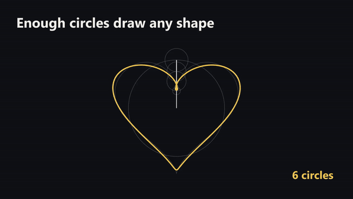
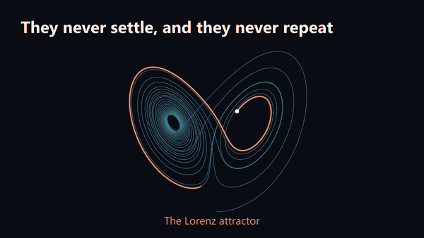

Idioma: [EN](README.md) | Español

<h1 align="center">ManimRS Studio</h1>

<p align="center">
  
  
  
</p>

ManimRS Studio es una app de escritorio de código abierto para charlas hechas con
[Manim Slides](https://github.com/jeertmans/manim-slides). Renderiza solo la diapositiva que
cambió, señala lo que está mal y deja que un agente lo arregle.


[Ver el tráiler como video](docs/images/trailer.mp4)

> [!IMPORTANT]
> **Esto es un prelanzamiento. La versión 1.0 todavía no existe.** No hay instalador, Linux es
> experimental y los formatos de archivo pueden cambiar. El proyecto todavía no recibe donaciones.

## Por qué

Manim Slides renderiza una charla como una sola escena. Si renderizas unas pocas diapositivas,
pierdes las demás. Si las renderizas todas, esperas por todas.

ManimRS Studio guarda cada diapositiva en su propio archivo, con sus videos. Cuando renderizas
una, las demás no cambian. Cada diapositiva sigue empezando con la transición de la anterior.

## Funciones

- **Una diapositiva a la vez.** *Render pending* renderiza solo las nuevas y las que cambiaron.
- **Señala, dibuja, mueve.** Marca el fotograma de una diapositiva. El fotograma marcado le llega
  al agente con tu nota.
- **Un chat que ve las diapositivas.** Claude renderiza una diapositiva, revisa la imagen de cada
  pausa y te muestra el resultado.
- **Tu agente, tu modelo.** Las herramientas de la app son un servidor MCP. Mira
  [Otros agentes](docs/es/other-agents.md).
- **Presentar y exportar.** Pantalla completa, HTML, PDF, MP4 y GIF.

<p>
  
</p>

## Ejemplos

El repositorio trae dos [charlas de ejemplo](examples/README.md), en inglés.

| Dibujar con círculos | Una mariposa en las ecuaciones |
| --- | --- |
|  |  |
| [`examples/fourier-circles`](examples/fourier-circles/) | [`examples/strange-attractor`](examples/strange-attractor/) |

## Instalación

Todavía no hay instalador. La app se compila desde el código. Hacen falta
[uv](https://docs.astral.sh/uv/), [FFmpeg](https://ffmpeg.org/), [Rust](https://rustup.rs/) y
[Node.js](https://nodejs.org/) 20 o posterior. El chat además usa
[Claude Code](https://claude.com/claude-code).

Pon este repositorio en la carpeta que tiene tus charlas. Si no tienes charlas, usa una carpeta
vacía.

```powershell
git clone https://github.com/JeroHoyos/manimrs-studio.git
cd manimrs-studio\frontend
npm ci
npm run build
cd ..
cargo build --release
.\target\release\manimrs-studio.exe
```

La app corre en Windows 10 y 11. Linux es experimental y macOS no tiene soporte. Mira
[Instalación](docs/es/installation.md) y [Problemas y soluciones](docs/es/problems.md).

## Uso

La interfaz está en inglés.

1. Abre la app y haz clic en *New talk*.
2. Haz clic en *Render 2 pending*. La primera vez, la charla instala sus paquetes de Python.
3. Haz clic en *Mark on the slide*, o escribe qué cambiar en *Review*. Después haz clic en
   *Send to Claude*.
4. Cuando la diapositiva esté bien, haz clic en *Approve*.
5. Haz clic en *Present* para pantalla completa, o en *Export* para HTML, PDF o MP4.

El [tutorial](docs/es/tutorial.md) muestra cada paso con imágenes. Toda la documentación está en
[docs/es](docs/es/index.md).

## Estado y hoja de ruta

- **Bien hoy:** renderizar una diapositiva, la revisión con marcas, el chat de Claude, las
  exportaciones, Windows.
- **Flojo:** Linux, otros agentes, los tipos del código de la ventana.
- **Sin empezar:** instaladores, macOS, tema oscuro, interfaz en español.

Los pasos hasta la 1.0 son instalador (0.7), TypeScript estricto y temas (0.8), un segundo agente
en el chat y notas del orador (0.9), y luego macOS y formatos estables (1.0).

## Contribuir

Se aceptan pull requests. Cada uno debe ser pequeño: una función o un arreglo. Antes de mandarlo,
corre las pruebas y la revisión de complejidad, compila la app y mira el cambio en la ventana:

```powershell
uv sync
uv run pytest
uv run complexipy .
cd frontend
npm ci
npm run build
cd ..
cargo build --release
```

[Cómo funciona](docs/es/how-it-works.md) muestra las partes del código. El código, los
comentarios y la documentación van en inglés.

Los errores y las ideas van en los [issues](https://github.com/JeroHoyos/manimrs-studio/issues).
No reportes una vulnerabilidad en un issue público: usa *Report a vulnerability* en la pestaña
*Security*.

## Licencia

ManimRS Studio es software libre bajo la [Licencia MIT](LICENSE). La app incluye marked (MIT),
DOMPurify (Apache-2.0 o MPL-2.0), Space Grotesk e IBM Plex Mono (SIL Open Font License 1.1), en
`frontend/apps/studio/public/`.

ManimRS Studio se apoya en [Manim Community](https://www.manim.community/) y
[Manim Slides](https://github.com/jeertmans/manim-slides). Los
[videos de 3Blue1Brown](https://github.com/3b1b/videos) son el modelo de las charlas de ejemplo,
[Recordly](https://github.com/webadderallorg/Recordly) el de esta página y
[ArtCraft](https://github.com/storytold/artcraft) el de la estructura del código. El proyecto no
es parte de Manim Community, de Manim Slides ni de Anthropic. Claude es una marca de Anthropic.
