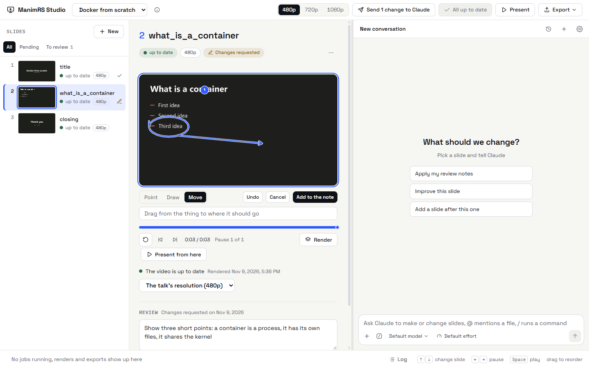
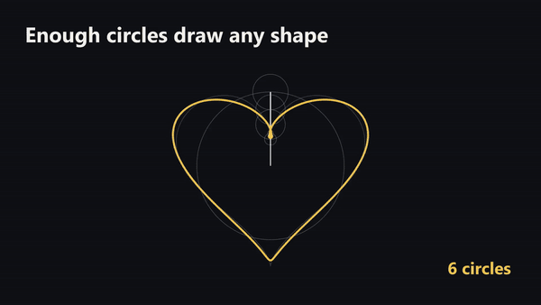
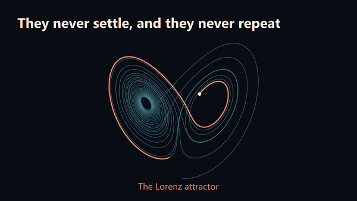

Language: EN | [Español](README.es.md)

<h1 align="center">ManimRS Studio</h1>

<p align="center">
  
  
  
</p>

ManimRS Studio is an open-source desktop app for talks made with
[Manim Slides](https://github.com/jeertmans/manim-slides). Render only the slide that changed,
point at what is wrong, and let an agent fix it.


[Watch the trailer as a video](docs/images/trailer.mp4)

> [!IMPORTANT]
> **This is a pre-release. Version 1.0 is not out.** There is no installer, Linux is experimental,
> and the file formats can change. The project does not take donations at this time.

## Why

Manim Slides renders a talk as one scene. If you render some slides, you lose the other slides.
If you render all the slides, you wait for all of them.

ManimRS Studio keeps each slide in a file of its own, with its videos. When you render one slide,
the other slides do not change. Each slide still starts with the transition from the slide before
it.

## Features

- **One slide at a time.** *Render pending* renders only the new slides and the slides that
  changed.
- **Point, draw, move.** Mark the frame of a slide. The marked frame goes to the agent with your
  note.
- **A chat that sees the slides.** Claude renders a slide, examines the image of each pause and
  shows you the result.
- **Your agent, your model.** The tools of the app are an MCP server. Refer to
  [Other agents](docs/other-agents.md).
- **Present and export.** Full screen, HTML, PDF, MP4 and GIF.

<p>
  
</p>

## Examples

The repository has two [example talks](examples/README.md).

| Drawing with circles | A butterfly in the equations |
| --- | --- |
|  |  |
| [`examples/fourier-circles`](examples/fourier-circles/) | [`examples/strange-attractor`](examples/strange-attractor/) |

## Installation

There is no installer at this time. Build the app from the source. These programs are necessary:
[uv](https://docs.astral.sh/uv/), [FFmpeg](https://ffmpeg.org/), [Rust](https://rustup.rs/) and
[Node.js](https://nodejs.org/) 20 or later. The chat also uses
[Claude Code](https://claude.com/claude-code).

Put this repository in the folder that holds your talks. If you do not have talks, use an empty
folder.

```powershell
git clone https://github.com/JeroHoyos/manimrs-studio.git
cd manimrs-studio\frontend
npm ci
npm run build
cd ..
cargo build --release
.\target\release\manimrs-studio.exe
```

The app runs on Windows 10 and 11. Linux is experimental and macOS is not supported. Refer to
[Installation](docs/installation.md) and [Problems and solutions](docs/problems.md).

## Usage

1. Start the app and click *New talk*.
2. Click *Render 2 pending*. The first time, the talk installs its Python packages.
3. Click *Mark on the slide*, or write what to change in *Review*. Then click *Send to Claude*.
4. When the slide is correct, click *Approve*.
5. Click *Present* for full screen, or *Export* for HTML, PDF or MP4.

The [tutorial](docs/tutorial.md) shows each step with images. All the
[documentation](docs/index.md) is also in [Spanish](docs/es/index.md).

## Status and Roadmap

- **Good today:** render one slide, review with marks, the Claude chat, the exports, Windows.
- **Thin:** Linux, other agents, the types of the window code.
- **Not started:** installers, macOS, a dark theme, the interface in Spanish.

The steps to version 1.0 are an installer (0.7), strict TypeScript and themes (0.8), a second
agent in the chat and speaker notes (0.9), then macOS and stable formats (1.0).

## Contribution

Pull requests are welcome. Keep each one small: one feature or one fix. Before you send it, run
the tests and the complexity check, then build the app and examine the change in the window:

```powershell
uv sync
uv run pytest
uv run complexipy .
cd frontend
npm ci
npm run build
cd ..
cargo build --release
```

[How it works](docs/how-it-works.md) shows the parts of the code. Write code, comments and
documentation in English, with the [documentation style](docs/writing-style.md).

Report bugs and ideas in the [issues](https://github.com/JeroHoyos/manimrs-studio/issues). Do not
report a vulnerability in a public issue. Use *Report a vulnerability* in the *Security* tab.

## License

ManimRS Studio is free software under the [MIT License](LICENSE). The app includes marked (MIT),
DOMPurify (Apache-2.0 or MPL-2.0), Space Grotesk and IBM Plex Mono (SIL Open Font License 1.1), in
`frontend/apps/studio/public/`.

ManimRS Studio stands on [Manim Community](https://www.manim.community/) and
[Manim Slides](https://github.com/jeertmans/manim-slides). The
[3Blue1Brown videos](https://github.com/3b1b/videos) are the model for the example talks,
[Recordly](https://github.com/webadderallorg/Recordly) for this page and
[ArtCraft](https://github.com/storytold/artcraft) for the layout of the code. The
project is not a part of Manim Community, Manim Slides or Anthropic. Claude is a trademark of
Anthropic.
