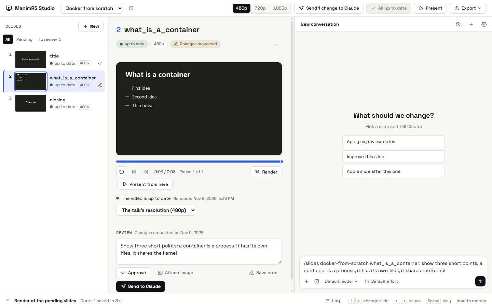
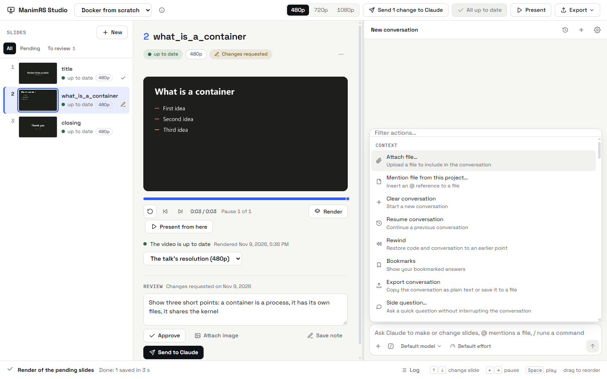

# Chat de Claude

[English](../claude-chat.md) | **Español**

El chat corre Claude Code sin terminal. La app muestra todo lo que hace Claude como mensajes,
pasos, tarjetas de permiso y preguntas.

## Pasos

La app pone en una sola fila lo que Claude piensa, sus llamadas a herramientas y las notas cortas
entre ellas. La fila muestra un resumen, por ejemplo «Edited a file, rendered 2 slides, and 7 more
steps». A la derecha muestra las imágenes que Claude miró.

Haz clic en la fila para ver cada paso. Haz clic en un paso para ver su detalle: el pensamiento, el
comando, el resultado o la imagen. La última respuesta de Claude queda debajo de la fila. La vista
de enfoque (*focus view*) oculta los pasos.

## La caja de mensaje

| Control | Resultado |
| --- | --- |
| Enter | Envía el mensaje. En los ajustes del chat puedes usar Ctrl+Enter. |
| `@` | Menciona un archivo de la carpeta de charlas o de la charla abierta. |
| `/` al inicio | Corre un comando. |
| `+` | Adjunta imágenes, PDF o archivos de texto. También puedes pegarlos o soltarlos. |
| Esc, o el botón cuadrado | Detiene a Claude. |

Puedes mandar más mensajes mientras Claude trabaja.

## Modo, modelo y esfuerzo

- **Modo.** Claude siempre trabaja en *Auto mode*. Hace las acciones seguras sin preguntar. Antes
  de una acción riesgosa, muestra una tarjeta de permiso.
- **Modelo y esfuerzo.** Elígelos con las etiquetas que están debajo de la caja de mensaje.

## Acciones

Haz clic en el botón `/` u oprime Ctrl+/ para ver las acciones. Son las mismas de la extensión de
Claude Code para VS Code:

| Grupo | Acciones |
| --- | --- |
| Context | Adjuntar un archivo, mencionar un archivo, limpiar, reanudar, rebobinar, marcadores, exportar, pregunta aparte. |
| Model | Cambiar de modelo, esfuerzo, modo rápido, cambio de modelo cuando un mensaje trae una marca, cuenta y límites de uso. |
| Customize | Estilos de salida, servidores MCP, hooks, permisos, memoria, instrucciones (CLAUDE.md), plugins, sandbox. |
| Settings | Estado, ajustes del chat (vista de enfoque, horas, Ctrl+Enter). |
| Support | Documentación de ayuda, reportar un problema, abrir la conversación en una terminal. |

*Rewind* devuelve el código, la conversación o ambos a como estaban antes de un mensaje. La lista
también muestra todos los comandos con barra.

Un enlace web en una respuesta de Claude se abre en tu navegador, no en la app.

## Historial

Haz clic en el botón del reloj para ver las conversaciones de la carpeta de charlas. Elige una
para continuarla.

## Charlas en otras carpetas

Claude trabaja en la carpeta de charlas y en las carpetas de las charlas que están en otros
lugares. Cuando abres o creas una charla durante una conversación, Claude recibe acceso a su
carpeta en la conversación siguiente. Hasta entonces, pregunta antes de cambiar archivos de esa
charla.

## Las herramientas MCP de la app

La app arranca un servidor MCP local para su sesión de Claude. Claude usa estas herramientas sin
tarjeta de permiso:

| Herramienta | Argumentos | Resultado |
| --- | --- | --- |
| `talks` | ninguno | Las charlas: nombre, título y carpeta de cada una. |
| `slides` | `talk` | Las diapositivas en orden: número, nombre, estado, revisión y archivo `.py`. |
| `notes` | `talk` | Los cambios que el usuario escribió en la revisión. |
| `render` | `talk`, `slides`, `quality` | Renderiza solo esas diapositivas. La app muestra el progreso y el video. |
| `view` | `talk`, `slide` | La imagen del final de cada pausa de una diapositiva. |
| `show` | `talk`, `slide` | Abre la diapositiva en la app. |
| `place` | `talk`, `method`, `after` | Agrega `self.<method>()` a `construct()`, después de una diapositiva o al final. |
| `export` | `talk`, `format` | Hace el paquete HTML (`html`) o el PDF (`pdf`). |
| `present` | `talk`, `start` | Abre el presentador. |

El valor de `talk` es el nombre que aparece en la lista de charlas, por ejemplo `charla-git`. El
prefijo `charla-` es opcional. El valor de `slide` es el nombre o el número de la diapositiva.

Para usar otro agente u otro modelo, mira [Otros agentes](other-agents.md).

## La skill slides

El comando `/slides` viene de la skill `slides` de Claude Code. La skill le dice a Claude el
procedimiento para una diapositiva. Claude lee las reglas de la charla y hace el cambio más
pequeño. Después renderiza la diapositiva, mira sus imágenes y se la muestra al usuario.

Claude Code encuentra la skill en `.claude/skills/slides/SKILL.md` de la carpeta de charlas. El
repositorio trae una copia en `manimrs-studio/.claude/skills/slides/`: cópiala a la carpeta de
charlas si no la tienes.
