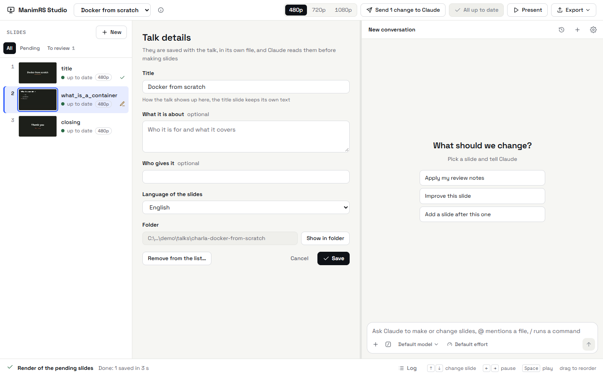

# Charlas

[English](../talks.md) | **Español**

## Charlas en cualquier carpeta

La lista de arriba en la app muestra todas las charlas que conoce el motor. Las charlas pueden
estar en cualquier carpeta. El motor guarda la lista en `manimrs-studio/talks.json`.

| Acción | Cómo se hace | Resultado |
| --- | --- | --- |
| Crear una charla | Elige *+ New talk* al final de la lista. Escribe el título, de qué trata la charla y el idioma de sus diapositivas. Haz clic en *Choose folder* para elegir dónde queda. | La charla nueva tiene una diapositiva de título y una de cierre. Si escribiste de qué trata, Claude propone las diapositivas y espera tu aprobación. |
| Abrir una charla | Elige *Open a talk…* y selecciona la carpeta de la charla. | La charla entra en la lista. Si la carpeta está vacía, se abre el formulario de charla nueva. |
| Ver o cambiar una charla | Haz clic en el botón **ⓘ** junto a la lista. | Un formulario muestra el título, de qué trata, el autor y el idioma. *Show in folder* abre la carpeta de la charla. |
| Quitar una charla de la lista | En el mismo formulario, haz clic en *Remove from the list…*. | El motor no borra archivos. Puedes abrir la charla otra vez más adelante. |



En *Open a talk…* puedes seleccionar cualquiera de estas carpetas:

- La carpeta de la charla.
- Su carpeta `presentacion`, por ejemplo `charla-git\presentacion`.
- La carpeta donde está su archivo `talk.manimrs`.

La primera vez, el motor agrega las charlas que están junto a `manimrs-studio` y que tienen un
archivo `presentacion/main.py`.

## El archivo talk.manimrs

Cada charla tiene un archivo `talk.manimrs` junto a su `main.py`. Es un archivo JSON que dice qué
es la charla. Puedes leerlo y cambiarlo con un editor de texto:

```json
{
  "manimrs": 1,
  "title": "Git y GitHub",
  "about": "Una introducción a Git y GitHub para principiantes",
  "author": "",
  "language": "es",
  "resolution": "1080p"
}
```

| Campo | Qué guarda |
| --- | --- |
| `title` | El nombre de la charla en la app. La diapositiva de título conserva su propio texto. |
| `about` | Para quién es la charla y de qué trata. Claude lo lee antes de hacer diapositivas. |
| `author` | Quien dicta la charla. |
| `language` | El idioma de las diapositivas, como código: `es`, `en`, `pt-BR`. |
| `resolution` | La resolución de la charla: `480p`, `720p` o `1080p`. Una diapositiva sin resolución propia se renderiza a esta resolución, y solo así queda al día. |

Si una charla no tiene `talk.manimrs`, el motor crea uno la primera vez que la abre. Toma el
título y el primer párrafo del `README.md` de la charla. El motor conserva los demás campos que
agregues al archivo.

## El formato de una charla

Una charla es una carpeta con un `main.py`. El motor lee la charla de estos archivos:

| Archivo | Qué tiene |
| --- | --- |
| `main.py` | Una escena de Manim Slides. Su método `construct()` llama las diapositivas en orden: `self.slide_<nombre>()`. |
| `diapositivas/__init__.py` | El registro de las diapositivas: `slide_<nombre> = _slide(<módulo>.build)`. |
| `diapositivas/<nombre>.py` | El contenido de una diapositiva: una función que recibe la escena y termina con `scene.next_slide()`. |
| `diapositivas/_template.py` | La plantilla de una diapositiva nueva. El texto `Slide title` se cambia por el nombre de la diapositiva. |
| `pyproject.toml` | Los paquetes de Python de la charla. |
| `talk.manimrs` | Qué es la charla. |

Reglas del formato:

- Una línea de comentario en `construct()` empieza un grupo de diapositivas. La app muestra el
  nombre del grupo encima de sus diapositivas.
- Una llamada comentada (`# self.slide_x()`) tiene el estado *commented out*. La app la muestra en
  gris.
- Una diapositiva puede estar más de una vez en `construct()`. La segunda llamada es `<nombre>-2`
  y la tercera, `<nombre>-3`.
- Cada diapositiva empieza con un paso que quita la anterior: `start_slide()`, o `iniciar_slide()`
  en las charlas más viejas.
- Las charlas más viejas tienen su código en `presentacion/`. Las que crea la app tienen todos los
  archivos en una sola carpeta.

## Una charla nueva

Una charla nueva recibe estos archivos:

| Archivo | Qué tiene |
| --- | --- |
| `talk.manimrs` | El título, de qué trata la charla y el idioma. |
| `README.md` | El título y de qué trata la charla. |
| `main.py` | La escena, con una diapositiva de título y una de cierre. |
| `style.py` | Los colores, la fuente y los tamaños de texto. Cámbialos aquí para cambiar todas las diapositivas. |
| `diapositivas/__init__.py` | El registro, con `title` y `closing`. |
| `diapositivas/title.py`, `closing.py` | Las dos primeras diapositivas. La de cierre usa el idioma de la charla. |
| `diapositivas/_template.py` | La plantilla de las diapositivas que agregues. |
| `pyproject.toml`, `.python-version` | Python 3.13, Manim menor que 0.22 y Manim Slides. Manim 0.22 no funciona con Manim Slides 5.7. |
| `.manim-slides.toml` | Las teclas del presentador. |
| `.gitignore` | Las carpetas que deja un render. |

La carpeta por defecto es `charla-<título>` en la carpeta de charlas. Puedes elegir otra carpeta y
otro nombre. Una carpeta vacía que ya exista también sirve.

## Los archivos de un render

El motor guarda los renders en la carpeta `diapos` de la charla. El render de una diapositiva no
cambia los archivos de las demás.

| Archivo | Qué tiene |
| --- | --- |
| `<nombre>.json` | Las pausas de la diapositiva y la ruta de cada video, en el formato de Manim Slides. |
| `files/<nombre>/` | Los videos de la diapositiva. |
| `_renders.json` | El código que produjo cada render: huellas de la diapositiva, de la anterior y del código compartido. |
| `_reviews.json` | Las notas y las aprobaciones de la revisión. |
| `_resolutions.json` | La resolución de cada diapositiva que tiene resolución propia. |
| `_thumbnails/` | Una imagen por diapositiva. |
| `_stills/` | Una imagen por pausa, para Claude. |
| `exported/` | Las exportaciones: paquete HTML, PDF, MP4 y GIF. |
| `_data.lock`, `_render.lock` | Candados. Solo un proceso a la vez cambia estos archivos o renderiza la charla. |

Las versiones viejas del motor usaban nombres en español para estos archivos. El motor los cambia
a los nombres nuevos la primera vez que abre la charla.
