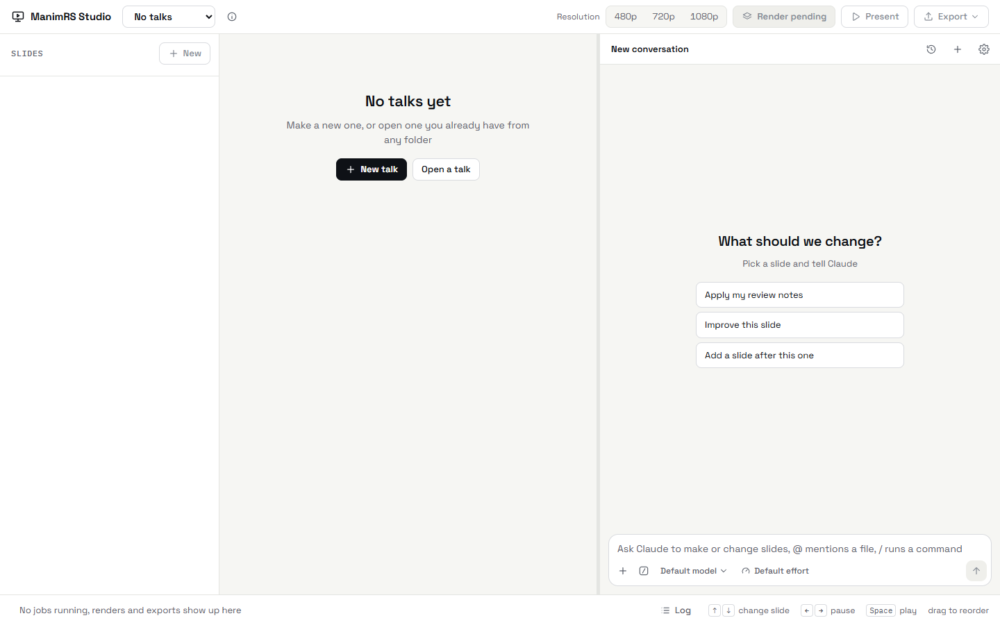
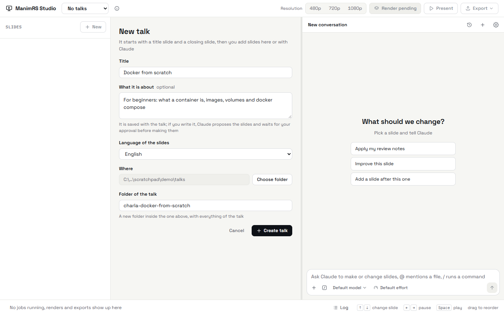
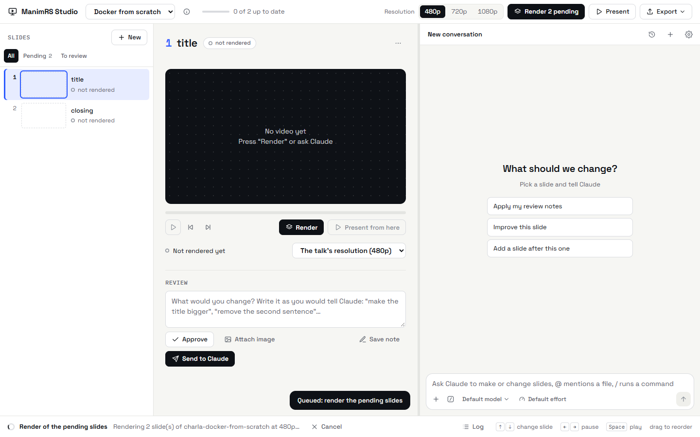
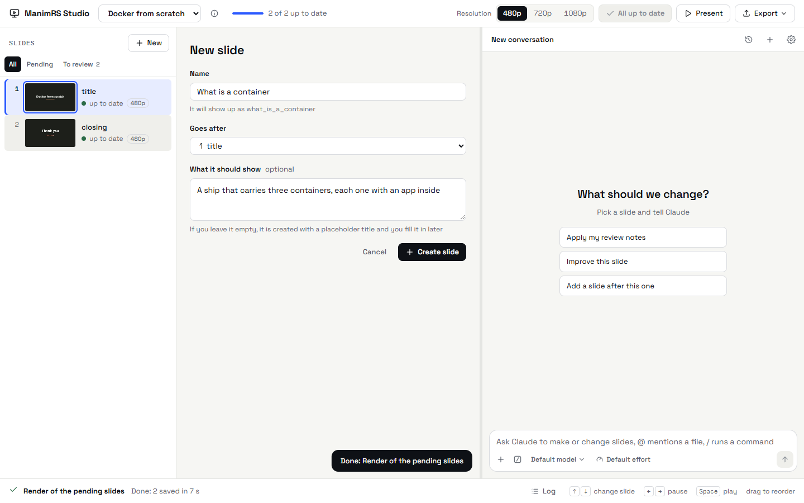
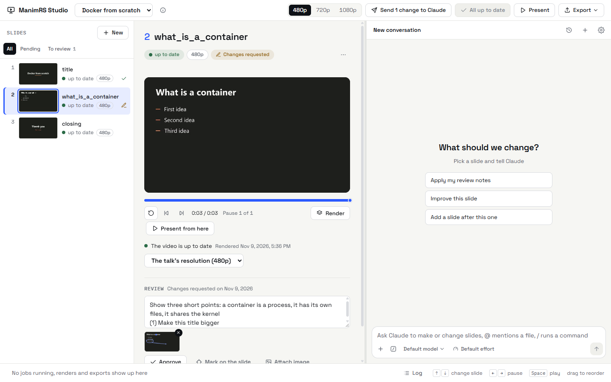
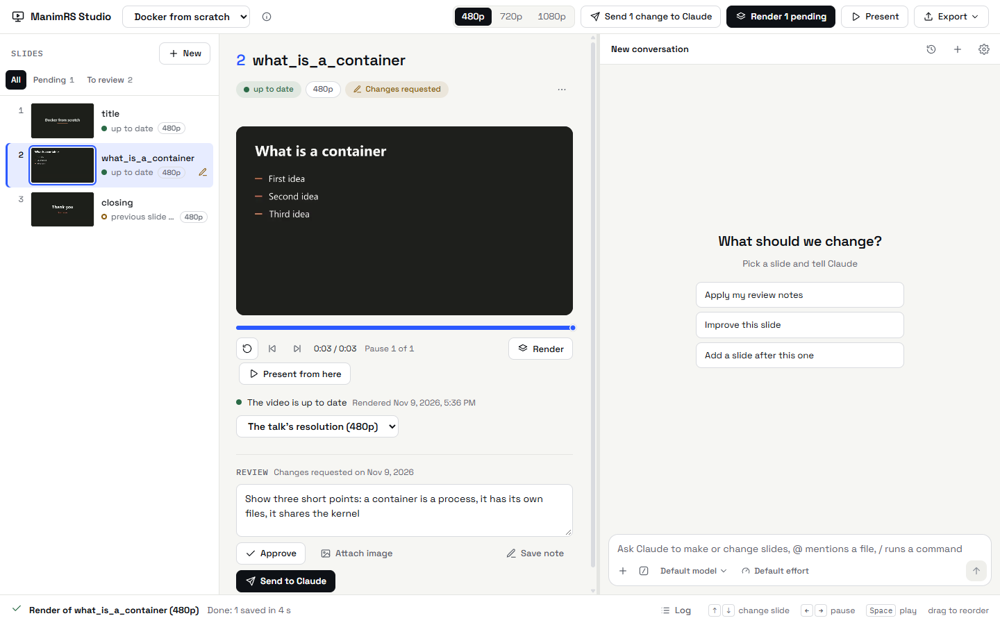
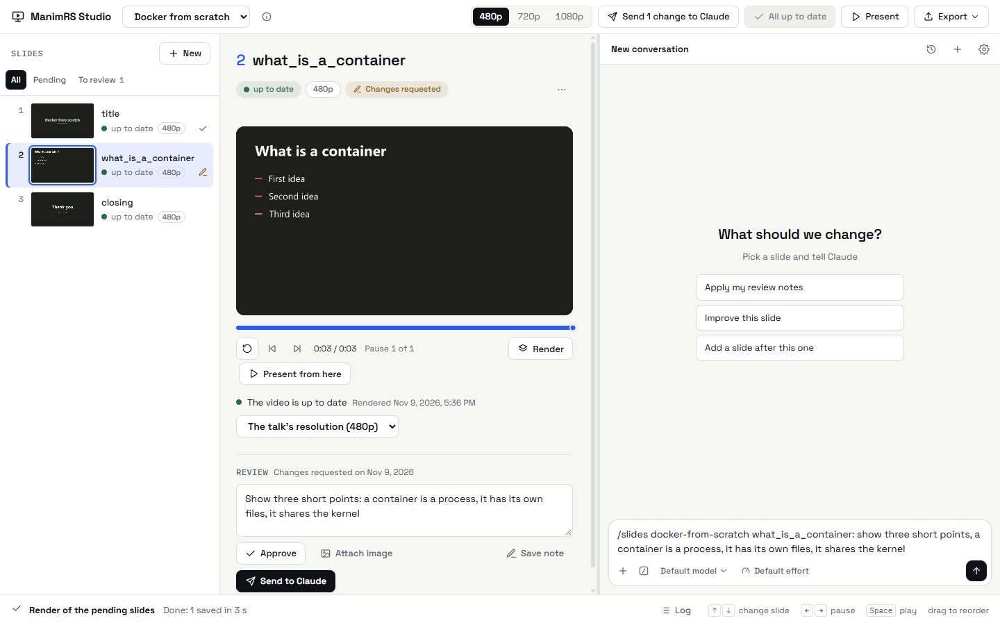
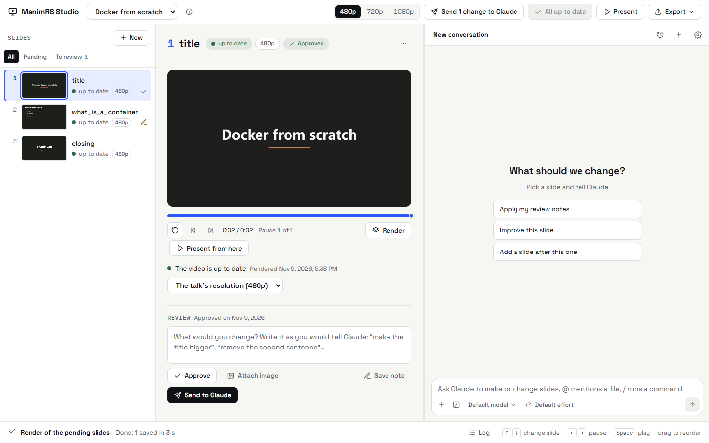
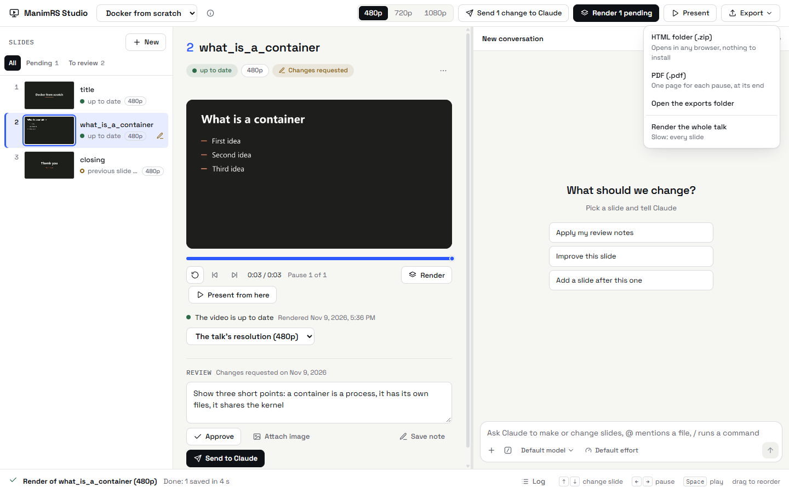

# Tutorial: tu primera charla

[English](../tutorial.md) | **Español**

En este tutorial haces una charla de tres diapositivas. La renderizas, la cambias con Claude, la
presentas y la exportas. Toma unos 15 minutos.

Antes de empezar, instala la app. Mira [Installation](installation.md).

La interfaz de la app está en inglés, así que los botones aparecen aquí con su nombre en inglés.

## 1. Abre la app

1. Abre `manimrs-studio.exe`, o haz doble clic en su acceso directo.
2. Mira la ventana. La primera vez, la app no tiene charlas.

Si la ventana muestra un mensaje sobre uv, WebView2 o Claude Code, mira
[Problems and solutions](problems.md).

## 2. Crea una charla

1. Haz clic en *New talk*.
2. Escribe el título: `Docker from scratch`.
3. Deja vacío *What it is about* en este tutorial.
4. Elige el idioma de las diapositivas.
5. Si quieres cambiar dónde queda la charla, haz clic en *Choose folder*.
6. Haz clic en *Create talk*.

La app crea una carpeta para la charla. La charla empieza con dos diapositivas: `title` y
`closing`. Las dos están en *not rendered*.

Si escribes de qué trata la charla, la app se lo envía a Claude. Claude propone la lista de
diapositivas y espera tu aprobación.

## 3. Renderiza las diapositivas

1. Haz clic en *480p*, arriba. A 480p una diapositiva sale más rápido.
2. Haz clic en *Render 2 pending*.
3. Espera el render. La barra de abajo muestra el avance.

El primer render de una charla instala sus paquetes de Python. Eso tarda unos minutos. Los
siguientes tardan unos segundos por diapositiva.

Cuando termina, cada diapositiva tiene su miniatura y el estado *up to date*.

## 4. Mira una diapositiva

1. Haz clic en la diapositiva `title`, en la lista de la izquierda.
2. Pulsa Espacio para reproducir el video o detenerlo.

Las demás teclas están en [Teclas](usage-guide.md#teclas).

## 5. Agrega una diapositiva

1. Haz clic en *+ New*, encima de la lista.
2. Escribe el nombre: `What is a container`.
3. Revisa que *Goes after* diga `1 title`.
4. Deja vacío *What it should show* en este tutorial.
5. Haz clic en *Create slide*.

La app crea el archivo de la diapositiva con la plantilla de la charla. La nueva diapositiva es
`what_is_a_container`, con un título y tres puntos.

Si escribes lo que debe mostrar la diapositiva, la app le envía la petición a Claude y Claude hace
el contenido.

6. Haz clic en *Render*, debajo del video.
7. Mira la lista. La diapositiva `closing` quedó en *previous slide changed*.

Cada diapositiva empieza con la transición desde la anterior. La anterior a `closing` ahora es
otra, así que su transición quedó vieja.

8. Haz clic en *Render 1 pending*, arriba.

## 6. Señala lo que quieres cambiar

1. Elige la diapositiva `what_is_a_container`.
2. Haz clic en *Mark on the slide*, en *Review*.
3. Con *Point*, haz clic sobre el título y escribe qué cambiar ahí.
4. Con *Draw*, encierra lo que quieras resaltar.
5. Con *Move*, arrastra desde un elemento hasta donde debe quedar.
6. Haz clic en *Add to the note*.

El fotograma con tus marcas queda como imagen de la nota. Lo que escribiste en cada punto queda en
la nota con su número.

## 7. Cambia la diapositiva con Claude

1. Completa la nota en *Review*. Por ejemplo:
   `Show three short points: a container is a process, it has its own files, it shares the kernel`.
2. Haz clic en *Send to Claude*.

Claude cambia el código de la diapositiva y la vuelve a renderizar. Después revisa la imagen de
cada pausa y te muestra la diapositiva en la app. El chat de la derecha muestra cada paso.

Para enviar varios cambios juntos, haz clic en *Save note* en cada diapositiva. La diapositiva
queda con la marca *Changes requested*. Luego haz clic en *Send N changes to Claude*, arriba.

También puedes escribir la petición en el chat. Empieza con `/slides`, la charla y la diapositiva:

El comando `/slides` viene de la skill `slides`. Mira
[Claude chat](claude-chat.md#la-skill-slides). Si usas otro agente (OpenCode, Codex, Gemini
CLI), mira [Other agents](other-agents.md).

## 8. Aprueba la diapositiva

1. Revisa el video nuevo.
2. Si quedó bien, haz clic en *Approve*.

La aprobación solo vale para el código que aprobaste. Si el código cambia, la revisión vuelve a
*to review*.

## 9. Presenta la charla

1. Haz clic en *Present*, arriba.
2. Pulsa la flecha derecha para ir a la siguiente pausa.
3. Pulsa Q para cerrar el presentador.

Para empezar en una diapositiva, elígela y haz clic en *Present from here*.

## 10. Exporta la charla

1. Haz clic en *1080p*, arriba.
2. Haz clic en *Render 3 pending* y espera el render.
3. Haz clic en *Export*.
4. Elige *HTML folder (.zip)* o *PDF (.pdf)*.

Cuando termina, un mensaje muestra *Open folder*. Haz clic ahí para ver el archivo.

## Qué sigue

| Para | Mira |
| --- | --- |
| Mover, renombrar o borrar diapositivas | [Usage guide](usage-guide.md#cambiar-las-diapositivas-de-una-charla) |
| Usar las opciones del chat | [Claude chat](claude-chat.md) |
| Usar otro agente u otro modelo | [Other agents](other-agents.md) |
| Abrir una charla de otra carpeta | [Talks](talks.md) |
| Encontrar la causa de un problema | [Problems and solutions](problems.md) |
