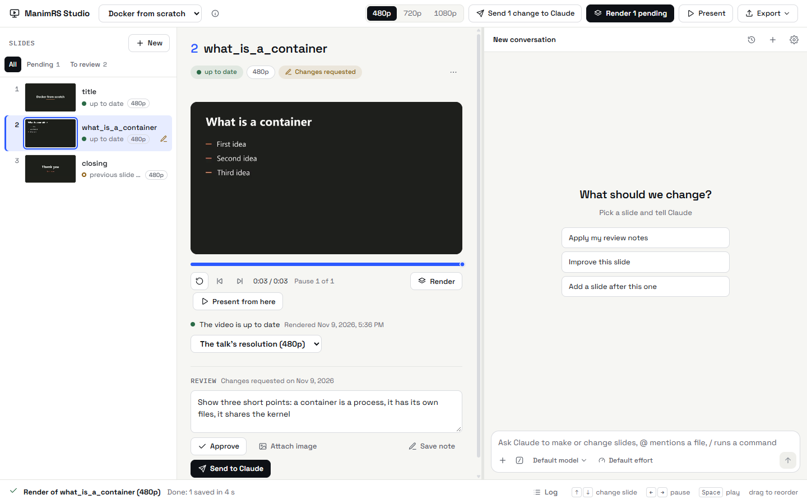
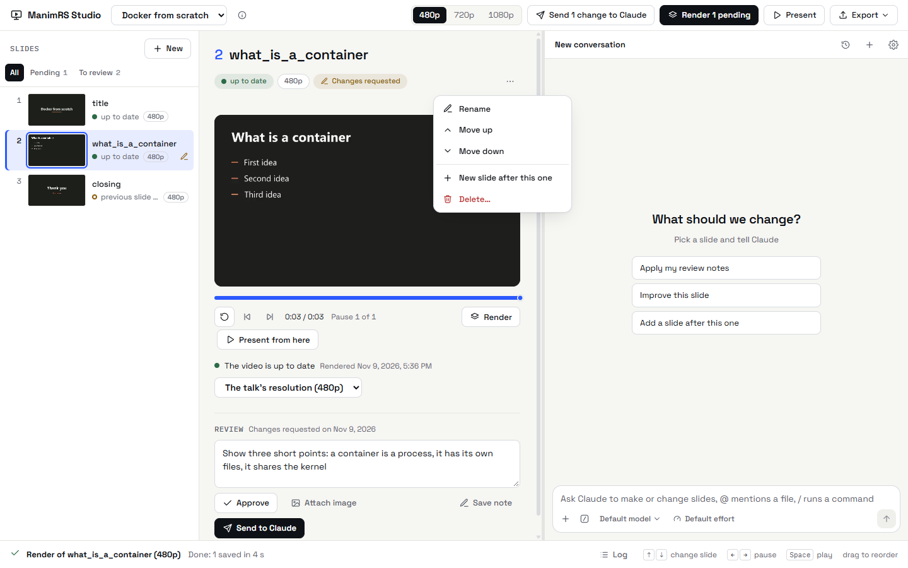
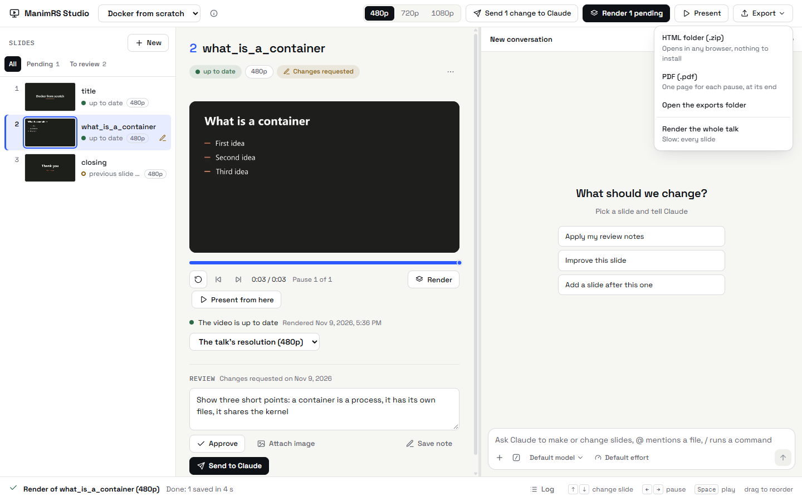

# Guía de uso

[English](../usage-guide.md) | **Español**

La interfaz de la app está en inglés, así que los botones y los estados aparecen aquí con su nombre
en inglés.

## La ventana

| Zona | Qué tiene |
| --- | --- |
| Arriba | La lista de charlas, la resolución de la charla, *Render pending*, *Present* y *Export*. |
| Izquierda | Las diapositivas, en el orden de la charla, cada una con su estado. |
| Centro | El video de la diapositiva seleccionada, su resolución y su revisión. |
| Derecha | El chat de Claude. Mira [Chat de Claude](claude-chat.md). |
| Abajo | El trabajo que está corriendo, con su progreso y *Cancel*. *Log* muestra la salida de cada trabajo. |

Arrastra la línea entre el centro y el chat para cambiar el ancho del chat. Oprime Ctrl y + o Ctrl
y - para cambiar el tamaño del contenido.

## Teclas

| Tecla | Resultado |
| --- | --- |
| Flecha arriba, flecha abajo | Selecciona la diapositiva anterior o la siguiente. |
| Re Pág, Av Pág | Se mueve diez diapositivas en la lista. |
| Inicio, Fin | Selecciona la primera o la última diapositiva. |
| Flecha izquierda, flecha derecha | Va a la pausa anterior o a la siguiente. |
| Espacio | Reproduce el video o lo detiene. |
| F2 | Cambia el nombre de la diapositiva. |
| Esc | Cierra un menú o el registro. En el chat, Esc detiene a Claude. |

Las teclas funcionan cuando el cursor no está en una caja de texto ni en el chat.

## Hacer las diapositivas con Claude

1. Elige la charla en la lista de arriba.
2. La primera vez, haz clic en *Render pending*.
3. Escribe una petición en el chat. Por ejemplo: `/slides git: a new slide after git_diff that explains git stash`.
4. Espera a Claude. La app muestra cada paso mientras Claude trabaja.
5. Mira el video de la diapositiva en el centro.
6. Escribe en *Review* lo que hay que cambiar y haz clic en *Send to Claude*.
7. Cuando la diapositiva esté bien, haz clic en *Approve*.

Para mandar varios cambios juntos, escribe cada nota y haz clic en *Save note*. Después haz clic en
*Send N changes to Claude*, arriba.

Para mostrarle a Claude una imagen con la nota, haz clic en *Attach image*. También puedes pegar o
soltar la imagen en *Review*. Las imágenes le llegan a Claude con la nota. La app guarda las
imágenes que no mandaste solo hasta que la cierras.

## Marcar sobre la diapositiva

Para mostrar lo que quieres cambiar, márcalo sobre la diapositiva. Las marcas le llegan a Claude
como una imagen.

1. Detén el video en el momento que quieres marcar.
2. Haz clic en *Mark on the slide*, en *Review*.
3. Elige una herramienta y marca el fotograma.
4. Haz clic en *Add to the note*.

| Herramienta | Cómo se usa | Resultado |
| --- | --- | --- |
| *Point* | Haz clic en una parte de la diapositiva. Después escribe qué cambiar ahí. | Un punto con un número. El texto entra en la nota con ese número. |
| *Draw* | Arrastra sobre la diapositiva. | Una línea, por ejemplo alrededor de un elemento. |
| *Move* | Arrastra desde un elemento hasta su posición nueva. | Una flecha. |

*Undo* o Ctrl+Z quita la última marca. *Cancel* o Esc cierra las marcas y no agrega nada.

La app guarda el texto de una nota que no guardaste ni mandaste, hasta que la cierras.

El primer render de una charla instala sus paquetes de Python. Toma unos minutos.

## El estado de una diapositiva

| Estado | Qué significa |
| --- | --- |
| up to date | El video coincide con el código. |
| not rendered | La diapositiva no tiene video. |
| changed | El archivo `.py` de la diapositiva cambió después del render. |
| previous slide changed | La diapositiva anterior cambió. La transición hacia esta quedó vieja. |
| shared code changed | Cambió un archivo que usan muchas diapositivas, por ejemplo el estilo. Renderiza otra vez solo si la diapositiva lo usa. |
| different resolution | El video tiene una resolución distinta a la de la diapositiva. Una diapositiva sin resolución propia usa la de la charla. |
| commented out | La llamada de la diapositiva en `main.py` está comentada. La charla no la muestra. |

Si un archivo tiene muchas diapositivas, un cambio en ese archivo cambia el estado de todas.

Una aprobación vale solo para el código que aprobaste. Si el código de la diapositiva cambia, la
revisión vuelve a *to review*.

## Cambiar las diapositivas de una charla

Todas estas acciones están en el menú *⋯* de la diapositiva y en el menú contextual de la lista.

| Acción | Cómo se hace | Resultado |
| --- | --- | --- |
| Agregar una diapositiva | Haz clic en *+ New*. Escribe un nombre y elige la diapositiva que va antes. | La app crea el archivo desde la plantilla de la charla, lo registra y lo pone en `main.py`. Si escribes qué muestra la diapositiva, la app le manda la petición a Claude. |
| Mover una diapositiva | Arrastra la diapositiva en la lista, con el filtro *All*. O usa *Move up* y *Move down*. | Las diapositivas que quedan con una transición nueva pasan a *previous slide changed*. |
| Renombrar una diapositiva | Haz doble clic en el título, u oprime F2, o elige *Rename*. | La app también renombra los videos. No hace falta renderizar otra vez. |
| Borrar una diapositiva | Elige *Delete…*. | El archivo de la diapositiva va a la papelera de Windows. Puedes recuperarlo de ahí. |
| Devolver una diapositiva | Selecciona una diapositiva con el estado *commented out* y haz clic en *Put it back*. | La llamada en `main.py` deja de estar comentada. |

## Resolución

- La resolución de arriba (480p, 720p o 1080p) es la de la charla. La app la guarda en el archivo
  `talk.manimrs` de la charla.
- Una diapositiva puede tener su propia resolución. Elígela junto al estado de la diapositiva.
- Una diapositiva sin resolución propia usa la de la charla. Si su video tiene otra resolución, la
  diapositiva queda en *different resolution* hasta que la renderizas otra vez.
- Cuando cambias la resolución de la charla, *Render pending* renderiza otra vez las diapositivas
  que la usan.

Una diapositiva toma unos 10 segundos a 480p y unos 30 segundos a 1080p. Usa 480p para revisar las
diapositivas y 1080p para presentarlas.

## Presentar una charla

1. Haz clic en *Present*.
2. Oprime la flecha derecha para ir a la pausa siguiente.
3. Oprime la flecha izquierda para devolverte.

| Tecla | Resultado |
| --- | --- |
| F | Cambia entre pantalla completa y ventana. |
| Esc | Sale de la pantalla completa. |
| Q | Cierra el presentador. |

El presentador muestra solo las diapositivas que tienen video. Te dice los nombres de las que no
muestra.

## Exportar una charla

| Exportación | Resultado | Uso |
| --- | --- | --- |
| HTML folder (.zip) | `diapos/exported/<charla>.zip` en la carpeta de la charla. | Descomprímelo en el otro equipo y abre `<charla>.html` con Chrome, Edge, Firefox o Safari. No necesita internet. |
| PDF (.pdf) | `diapos/exported/<charla>.pdf` | Cada pausa es una página, con el último fotograma de la pausa. Un bucle no tiene página si antes hay una pausa en su diapositiva, porque el bucle termina en esa página. La exportación a PDF necesita FFmpeg. |
| Video (.mp4) | `diapos/exported/<charla>.mp4` | Todas las diapositivas en un video, a la resolución de la charla. El video no tiene pausas. |
| Una diapositiva (.mp4, .gif) | `diapos/exported/<diapositiva>.mp4` o `.gif` | Abre el menú de la diapositiva y elige *Export as video* o *Export as GIF*. |

La exportación trae solo las diapositivas que tienen video. Renderiza todas a 1080p antes de
exportar.

La primera exportación a HTML descarga reveal.js. Para esa exportación sí hace falta internet.
