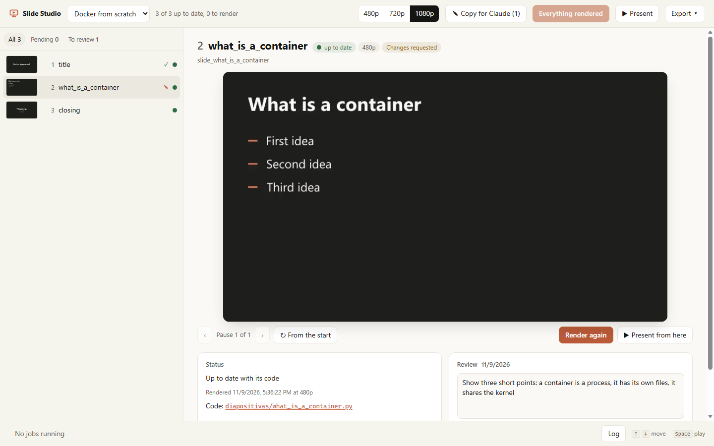

# Panel web

[English](../web-panel.md) | **Español**

El panel web muestra las diapositivas y la revisión en un navegador. Usa el mismo motor y los
mismos archivos que la app. Puedes usar la app, el panel web y los comandos al mismo tiempo.

## Abrir el panel web

1. Haz doble clic en `studio.cmd`, en la carpeta `manimrs-studio`.
2. Espera el navegador. Abre http://127.0.0.1:8765.

Para abrirlo desde una terminal, escribe `.\studio` en la carpeta `manimrs-studio`. Para detenerlo,
oprime Ctrl+C en la ventana de la terminal.

El panel web solo le responde a su propia página. Un sitio web abierto en el navegador no puede
mandarle peticiones ni mostrarlo dentro de un marco.

## Las partes del panel

| Parte | Qué tiene |
| --- | --- |
| Izquierda | Las diapositivas en el orden de `main.py`, cada una con un punto de estado. |
| Centro | El video de la diapositiva, una pausa a la vez (‹ ›), con *Render* y *Present from here*. Haz clic en el nombre del archivo para abrir el código en VS Code. |
| Review | Una nota para la diapositiva, con *Approve* y *Request changes*. |
| Arriba | *Render pending* renderiza las diapositivas nuevas y las que cambiaron. *Present* abre el presentador. *Export* hace el paquete para otro equipo. |

| Punto | Estado |
| --- | --- |
| Verde | up to date |
| Hueco | not rendered |
| Ámbar | changed |
| Anillo ámbar | previous slide changed |
| Azul | shared code changed |

## Mandarle cambios a Claude

1. Escribe en *Review* lo que hay que cambiar.
2. Haz clic en *Request changes*.
3. Repite los pasos 1 y 2 con cada diapositiva que deba cambiar.
4. Haz clic en *Copy for Claude*, arriba.
5. Pega el texto en un chat de Claude Code.

Para mandar una sola diapositiva, haz clic en *Copy for Claude* debajo de su nota.

Claude cambia solo esas diapositivas y las renderiza otra vez. Mira sus imágenes y te deja un
enlace a cada una. El panel muestra esas diapositivas como *to review*.
