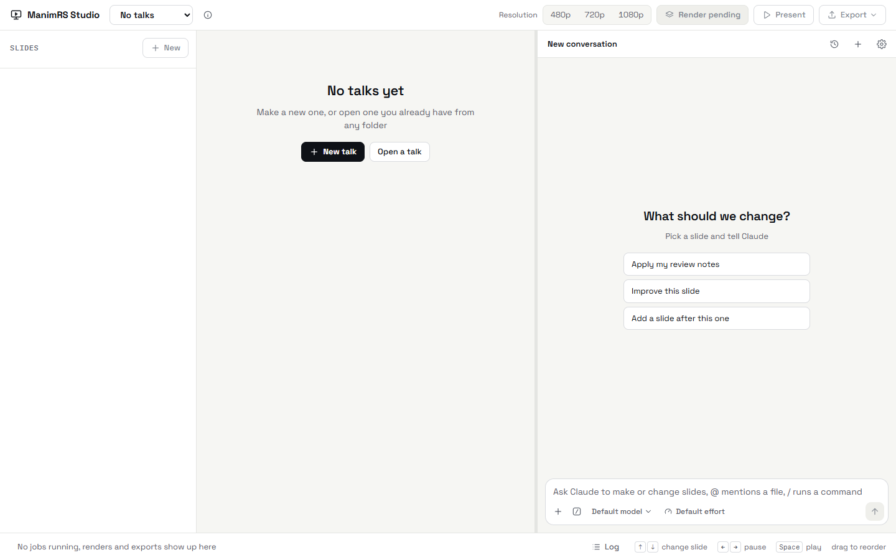
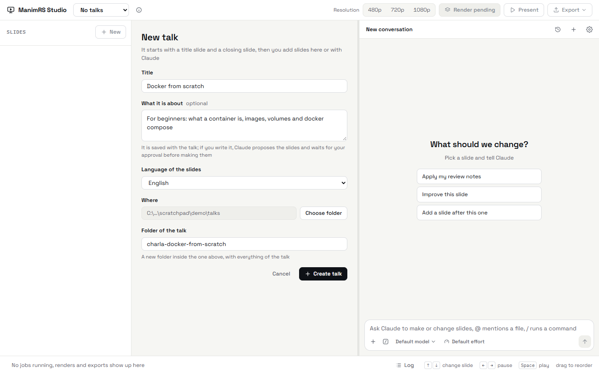
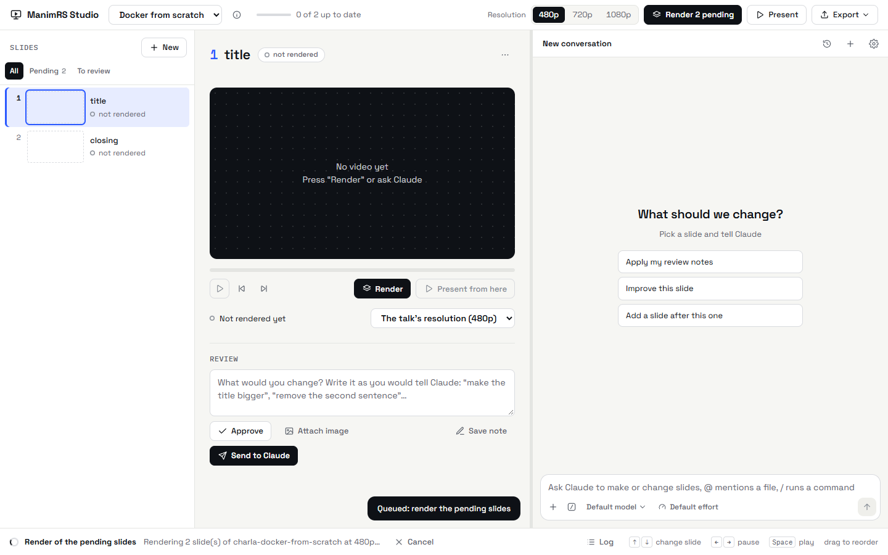
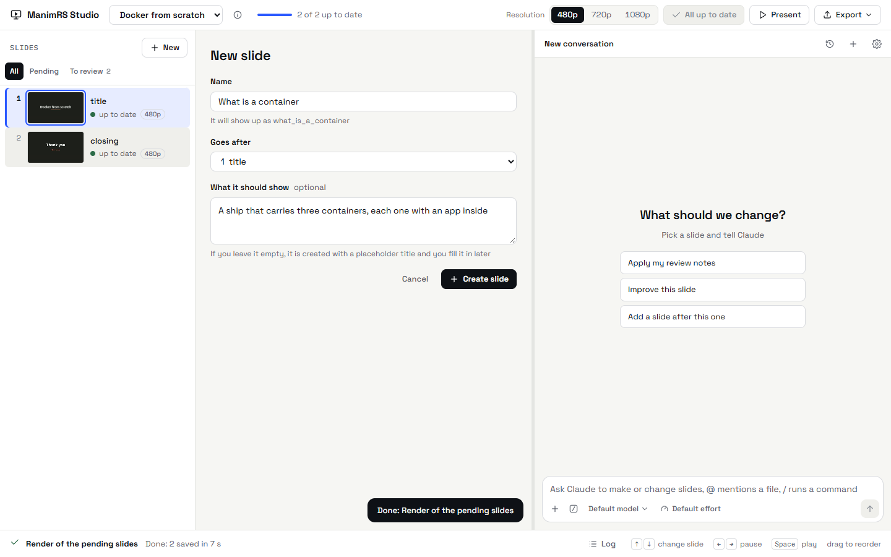
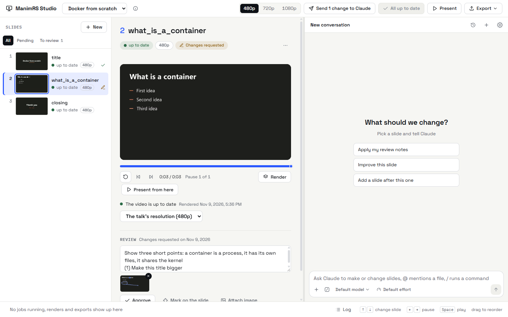
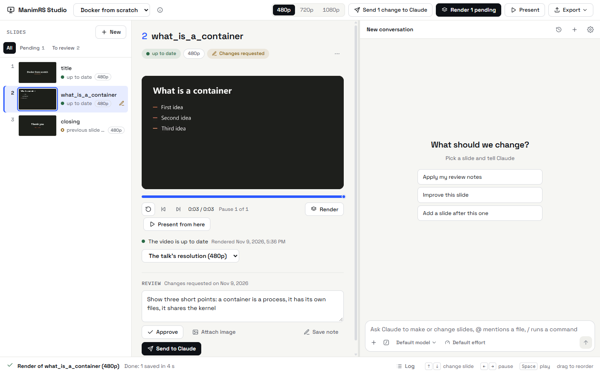
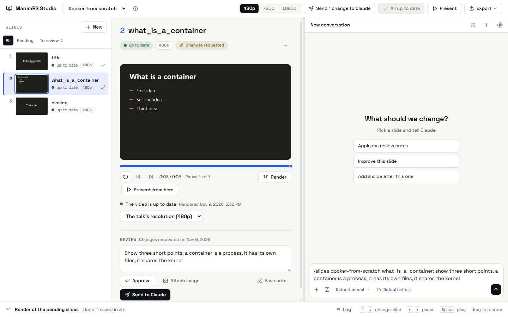
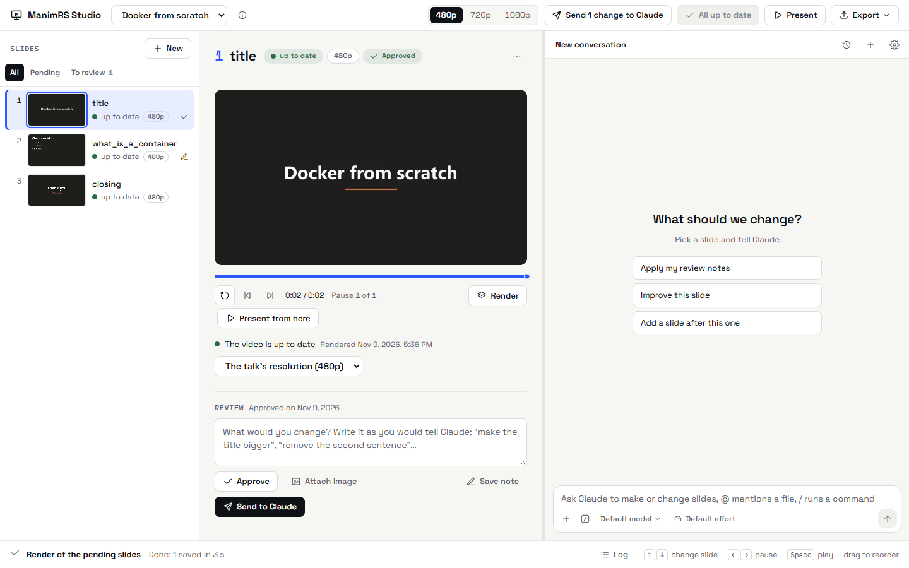
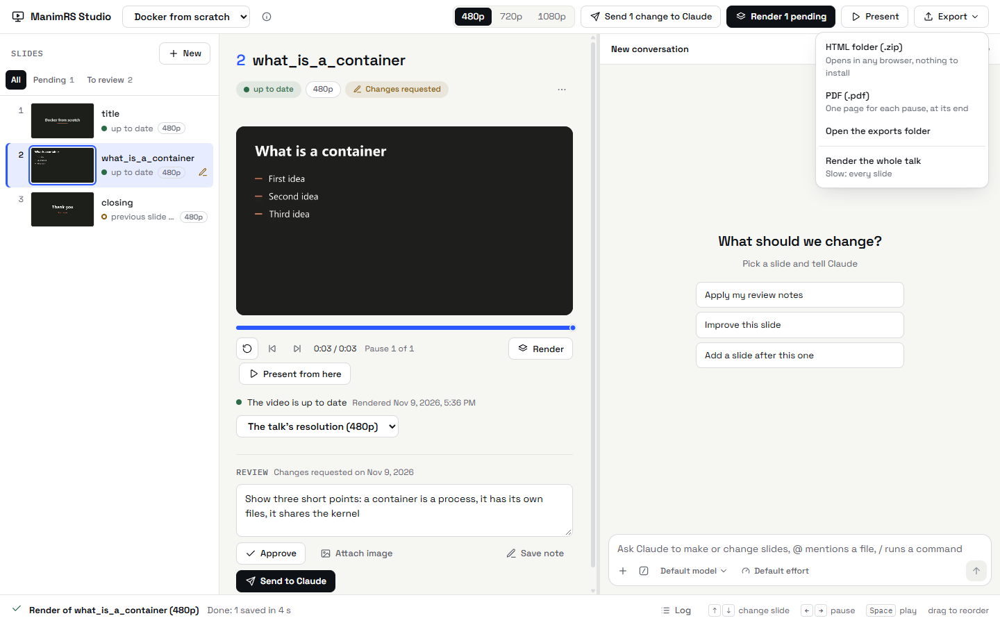

# Tutorial: your first talk

**English** | [Español](es/tutorial.md)

In this tutorial you make a talk with three slides. You render it, change it with Claude, present
it and export it. The tutorial takes approximately 15 minutes.

Before you start, install the app. Refer to [Installation](installation.md).

## 1. Start the app

1. Start `manimrs-studio.exe`, or double-click its shortcut.
2. Look at the window. The first time, the app has no talks.

If the window shows a message about uv, WebView2 or Claude Code, refer to
[Problems and solutions](problems.md).

## 2. Make a talk

1. Click *New talk*.
2. Type the title: `Docker from scratch`.
3. Keep *What it is about* empty for this tutorial.
4. Select the language of the slides.
5. Click *Choose folder* to change where the talk goes. This step is optional.
6. Click *Create talk*.

The app makes a folder for the talk. The talk starts with two slides: `title` and `closing`. The
two slides have the status *not rendered*.

If you write what the talk is about, the app sends it to Claude. Claude proposes the list of
slides and waits for your approval.

## 3. Render the slides

1. Click *480p* at the top. A slide renders faster at 480p.
2. Click *Render 2 pending*.
3. Wait for the render. The bar at the bottom shows the progress.

The first render of a talk installs its Python packages. This takes some minutes. The subsequent
renders take some seconds for each slide.

When the render ends, each slide has a thumbnail and the status *up to date*.

## 4. Look at a slide

1. Click the `title` slide in the list on the left.
2. Push Space to play the video or to stop it.

For the other keys, refer to [Keys](usage-guide.md#keys).

## 5. Add a slide

1. Click *+ New* above the list.
2. Type the name: `What is a container`.
3. Make sure that *Goes after* shows `1 title`.
4. Keep *What it should show* empty for this tutorial.
5. Click *Create slide*.

The app makes the file of the slide from the template of the talk. The new slide is
`what_is_a_container`, with a title and three points.

If you write what the slide must show, the app sends the request to Claude. Claude then makes
the content of the slide.

6. Click *Render* below the video.
7. Look at the list. The `closing` slide has the status *previous slide changed*.

Each slide starts with the transition from the slide before it. The slide before `closing` is
different now, thus its transition is old.

8. Click *Render 1 pending* at the top.

## 6. Point at what to change

1. Select the `what_is_a_container` slide.
2. Click *Mark on the slide* in *Review*.
3. With *Point*, click the title and write what to change there.
4. With *Draw*, draw a line around a part of the slide.
5. With *Move*, drag from an element to its new position.
6. Click *Add to the note*.

The frame with your marks is now an image of the note. The text of each point is in the note,
with the number of the point.

## 7. Change the slide with Claude

1. Write the other changes in *Review*. For example:
   `Show three short points: a container is a process, it has its own files, it shares the kernel`.
2. Click *Send to Claude*.

Claude changes the code of the slide and renders the slide again. Then Claude examines the image
of each pause and shows the slide in the app. The chat on the right shows each step.

To send many changes together, click *Save note* on each slide. The slide gets the mark
*Changes requested*. Then click *Send N changes to Claude* at the top.

You can also type a request in the chat. Start the request with `/slides`, the talk and the
slide:

The `/slides` command comes from the `slides` skill. Refer to
[Claude chat](claude-chat.md#the-slides-skill). For a different agent, refer to
[Other agents](other-agents.md).

## 8. Approve the slide

1. Examine the new video of the slide.
2. If the slide is correct, click *Approve*.

The approval is valid only for the code that you approved. If the code of the slide changes, the
review goes back to *to review*.

## 9. Present the talk

1. Click *Present* at the top.
2. Push the right arrow key to go to the next pause.
3. Push Q to close the presenter.

To start at a slide, select the slide and click *Present from here*.

## 10. Export the talk

1. Click *1080p* at the top.
2. Click *Render 3 pending* and wait for the render.
3. Click *Export*.
4. Select *HTML folder (.zip)* or *PDF (.pdf)*.

When the export ends, a message shows *Open folder*. Click it to see the file. For the contents of
each export, refer to [Export a talk](usage-guide.md#export-a-talk).

## Next steps

| To do this | Refer to |
| --- | --- |
| Move, rename or delete slides | [Change the slides of a talk](usage-guide.md#change-the-slides-of-a-talk) |
| Use the options of the chat | [Claude chat](claude-chat.md) |
| Use a different agent or model | [Other agents](other-agents.md) |
| Open a talk from a different folder | [Talks](talks.md) |
| Write the code of a slide | [The format of a talk](talks.md#the-format-of-a-talk) |
| Use the engine from a terminal | [Command reference](cli-reference.md) |
| Find the cause of a problem | [Problems and solutions](problems.md) |
