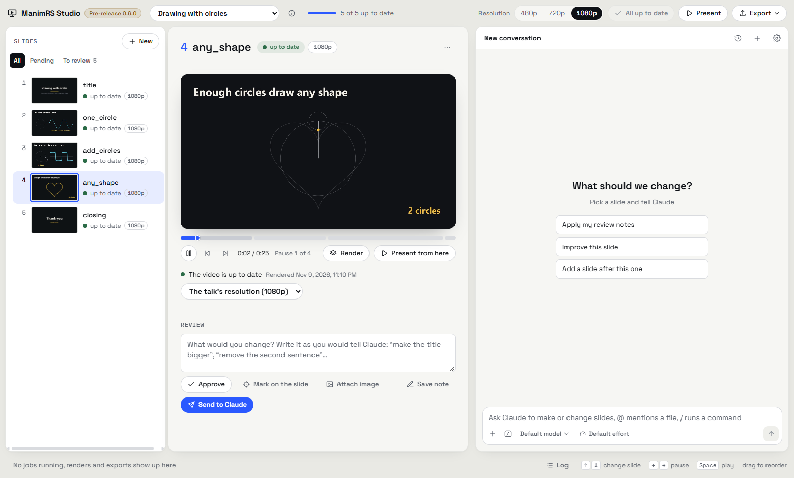
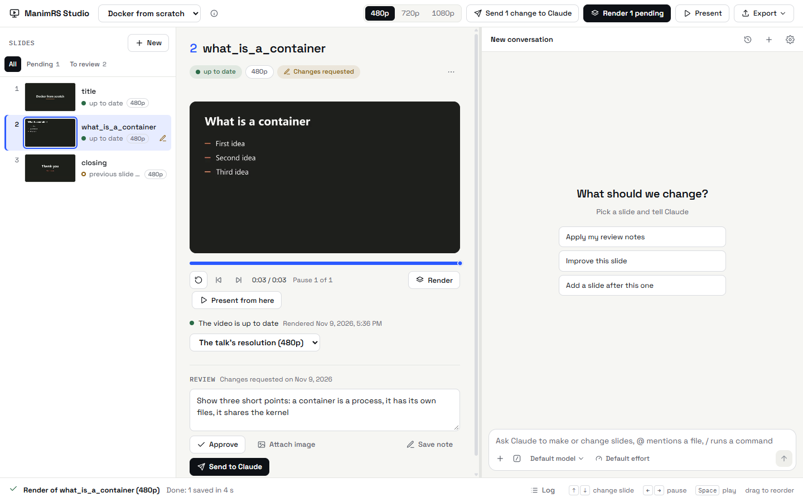
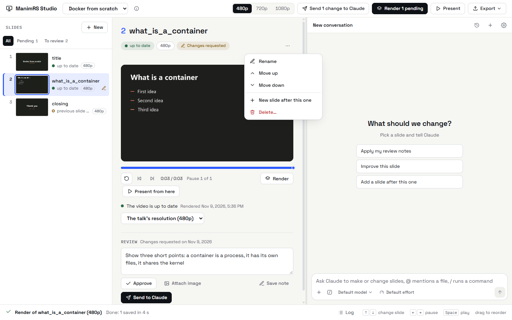
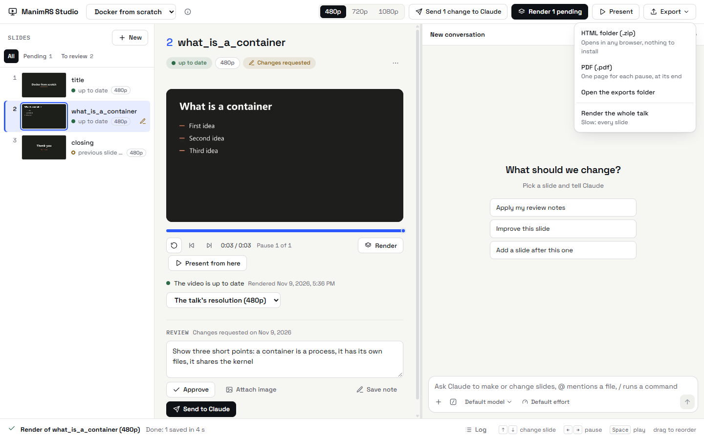

# Usage guide

## The window

| Area | Contents |
| --- | --- |
| Top | The list of talks, the resolution of the talk, *Render pending*, *Present* and *Export*. |
| Left | The slides, in the order of the talk, each with its status. |
| Center | The video of the selected slide, its resolution and its review. |
| Right | The Claude chat. For more information, refer to [Claude chat](claude-chat.md). |
| Bottom | The job that runs, with its progress and *Cancel*. *Log* shows the output of each job. |

Drag the line between the center and the chat to change the width of the chat. Push Ctrl and + or
Ctrl and - to change the size of the contents.

## Keys

| Key | Result |
| --- | --- |
| Up arrow, Down arrow | Selects the slide before or the slide after. |
| Page Up, Page Down | Moves ten slides in the list. |
| Home, End | Selects the first slide or the last slide. |
| Left arrow, Right arrow | Goes to the pause before or to the pause after. |
| Space | Plays the video or stops it. |
| F2 | Changes the name of the slide. |
| Esc | Closes a menu or the log. In the chat, Esc stops Claude. |

The keys work when the cursor is not in a text box and not in the chat.

## Make the slides with Claude

1. Select the talk in the list at the top.
2. The first time, click *Render pending*.
3. Type a request in the chat. For example: `/slides git: a new slide after git_diff that explains git stash`.
4. Wait for Claude. The app shows each step while Claude works.
5. Examine the video of the slide in the center.
6. Write what to change in *Review*, then click *Send to Claude*.
7. When the slide is correct, click *Approve*.

To send many changes together, write each note and click *Save note*. Then click
*Send N changes to Claude* at the top.

To show Claude an image with the note, click *Attach image*. You can also paste or drop the image
in *Review*. The images go to Claude with the note. The app keeps the images that you did not send
only until you close it.

## Mark on the slide

To show what you want to change, mark it on the slide. The marks go to Claude as an image.

1. Stop the video at the moment that you want to mark.
2. Click *Mark on the slide* in *Review*.
3. Select a tool and mark the frame.
4. Click *Add to the note*.

| Tool | Procedure | Result |
| --- | --- | --- |
| *Point* | Click a part of the slide. Then write what to change there. | A point with a number. The text goes into the note with that number. |
| *Draw* | Drag on the slide. | A line, for example around an element. |
| *Move* | Drag from an element to its new position. | An arrow. |

*Undo* or Ctrl+Z removes the last mark. *Cancel* or Esc closes the marks and adds nothing.

The app keeps the text of a note that you did not save or send, until you close the app.

The first render of a talk installs its Python packages. This takes some minutes.

## The status of a slide

| Status | Definition |
| --- | --- |
| up to date | The video agrees with the code. |
| not rendered | The slide has no video. |
| changed | The `.py` file of the slide changed after the render. |
| previous slide changed | The slide before it changed. The transition into this slide is old. |
| shared code changed | A file that many slides use changed, for example the style. Render again only if the slide uses it. |
| different resolution | The video has a different resolution from the slide. A slide without its own resolution uses the resolution of the talk. |
| commented out | The call of the slide in `main.py` is a comment. The talk does not show it. |

If a file holds many slides, a change to that file changes the status of all of them.

An approval is valid only for the code that you approved. If the code of the slide changes, the
review goes back to *to review*.

## Change the slides of a talk

All these actions are in the *⋯* menu of the slide and in the context menu of the list.

| Action | Procedure | Result |
| --- | --- | --- |
| Add a slide | Click *+ New*. Type a name and select the slide that comes before it. | The app makes the file from the template of the talk, registers it and puts it in `main.py`. If you write what the slide shows, the app sends the request to Claude. |
| Move a slide | Drag the slide in the list, with the *All* filter. Or use *Move up* and *Move down*. | The slides that get a new transition change to *previous slide changed*. |
| Rename a slide | Double-click the title, or push F2, or select *Rename*. | The app also renames the videos. It is not necessary to render the slide again. |
| Delete a slide | Select *Delete…*. | The file of the slide goes to the recycle bin of Windows. You can get it back from there. |
| Put back a slide | Select a slide with the status *commented out*, then click *Put it back*. | The call in `main.py` is not a comment now. |

## Resolution

- The resolution at the top (480p, 720p or 1080p) is the resolution of the talk. The app keeps it
  in the `talk.manimrs` file of the talk.
- A slide can have its own resolution. Select it next to the status of the slide.
- A slide without its own resolution uses the resolution of the talk. If its video has a different
  resolution, the slide is *different resolution* until you render it again.
- When you change the resolution of the talk, *Render pending* renders again the slides that use it.

A slide takes approximately 10 seconds at 480p and 30 seconds at 1080p. Use 480p to examine the
slides and 1080p to present them.

## Present a talk

1. Click *Present*.
2. Push the right arrow key to go to the next pause.
3. Push the left arrow key to go back.

| Key | Result |
| --- | --- |
| F | Change between full screen and a window. |
| Esc | Leave full screen. |
| Q | Close the presenter. |

The presenter shows only the slides that have a video. It tells you the names of the slides that it
does not show.

## Export a talk

| Export | Result | Use |
| --- | --- | --- |
| HTML folder (.zip) | `diapos/exported/<talk>.zip` in the folder of the talk. | Unzip it on the other device and open `<talk>.html` with Chrome, Edge, Firefox or Safari. A connection to the internet is not necessary. |
| PDF (.pdf) | `diapos/exported/<talk>.pdf` | Each pause is a page. The page shows the last frame of the pause. A loop gets no page if a pause comes before it in its slide, because the loop ends on that page. The PDF export needs FFmpeg. |
| Video (.mp4) | `diapos/exported/<talk>.mp4` | All the slides in one video, at the resolution of the talk. The video has no pauses. |
| One slide (.mp4, .gif) | `diapos/exported/<slide>.mp4` or `.gif` | Open the menu of the slide and select *Export as video* or *Export as GIF*. |

The export has only the slides that have a video. Render all the slides at 1080p before you export.

The first HTML export downloads reveal.js. For that export, a connection to the internet is necessary.
