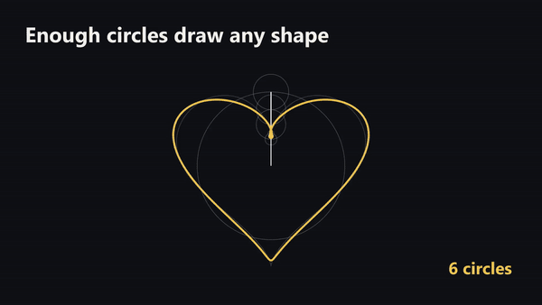
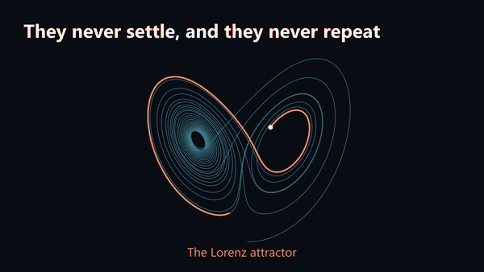

# Example talks

Two short talks show what a talk made with ManimRS Studio looks like. Each slide shows one idea
that moves, in the style of the [3Blue1Brown videos](https://github.com/3b1b/videos). The code is
new and does not use LaTeX.

| Talk | Folder | Slides | What it shows |
| --- | --- | --- | --- |
| Drawing with circles | [`fourier-circles/`](fourier-circles/) | 5 | A sum of circles that turn draws a wave, then a square wave, then a heart. |
| A butterfly in the equations | [`strange-attractor/`](strange-attractor/) | 5 | The Lorenz system: three rules, a path that never repeats, and two starts that go apart. |





## Open an example

1. Start the app.
2. Select *Open a talk…* in the list of talks.
3. Select the folder of the example, for example `examples/fourier-circles`.
4. Click *Render pending*. The first time, the talk installs its Python packages.
5. Click *Present*.

From a terminal, in the folder that holds `manimrs-studio`:

```powershell
manimrs-studio\studio.cmd open manimrs-studio\examples\fourier-circles
manimrs-studio\studio.cmd fourier-circles render --pending
manimrs-studio\studio.cmd fourier-circles present
```

## What to learn from them

- **A helper file for the hard part.** `epicycles.py` and `lorenz.py` hold the mathematics. The
  slides only tell the story. The engine sees a change to a helper file and marks the slides that
  use it.
- **One tracker moves all the parts.** Each slide has a `ValueTracker` for the time. The circles,
  the line and the wave read it. This keeps the parts in step.
- **A pause for each step of the idea.** `add_circles.py` shows 1, 2, 4 and 16 circles, with a
  pause after each one.
- **A loop while you talk.** `the_attractor.py` ends with `next_slide(loop=True)`. The attractor
  turns until you continue.
- **The colors are in one file.** Change `style.py` and all the slides change.
